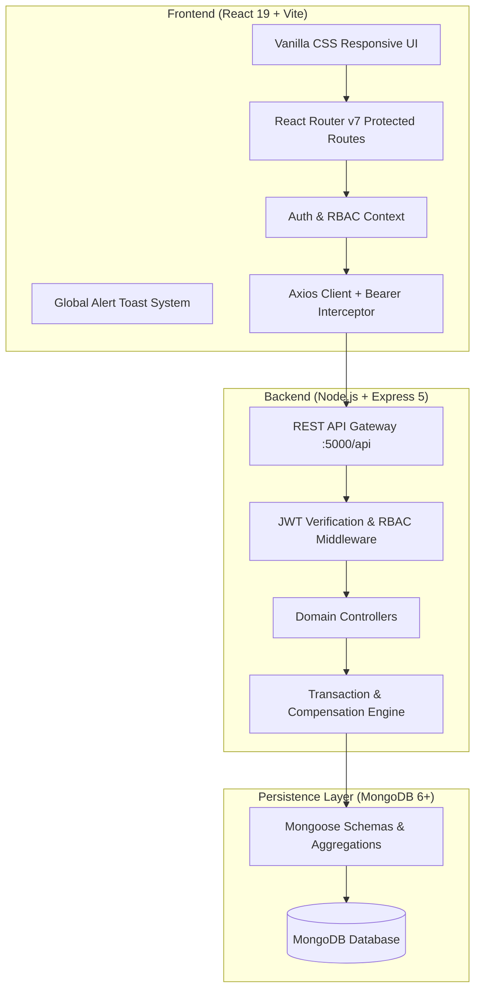
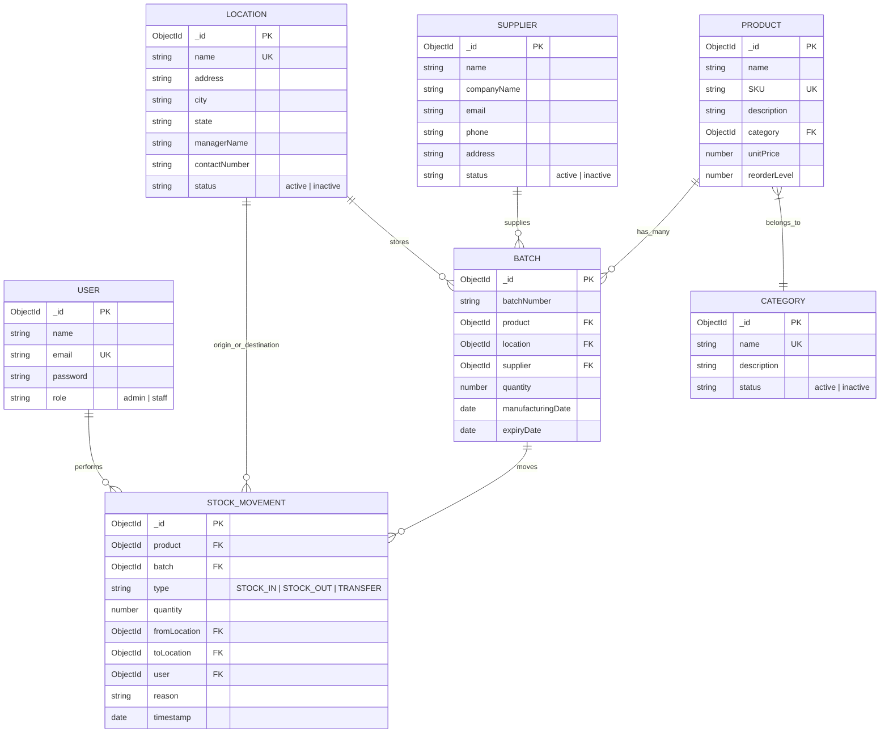

# Enterprise Inventory Management & Supply Chain Tracking System (IMS)

## 1. Executive Summary & Architecture Overview

The **Enterprise Inventory Management System (IMS)** is a full-stack, enterprise-grade warehouse management and supply chain monitoring platform. It is engineered to deliver end-to-end visibility across multi-warehouse supply networks, enforce strict inventory equilibrium, provide batch shelf-life audits, prevent negative inventory dispatches, and offer real-time analytics with exportable business intelligence reports.



### Core Technical Stack
* **Frontend**: React 19, Vite 8, React Router DOM v7, Axios, Vanilla CSS3 (Custom Dark Theme Design System, CSS Variables, Responsive Grid/Flexbox).
* **Backend**: Node.js v18+, Express 5, JSON Web Token (`jsonwebtoken`), Cryptographic Hashing (`bcryptjs`), CORS.
* **Database & ODM**: MongoDB v6+, Mongoose v8/v9 (Schema indexing, unique compound indexes, aggregation pipelines).
* **Security & Access Control**: Stateless JWT Authentication with Bearer tokens, HTTP request interceptors, and strict Role-Based Access Control (**Admin** vs. **Staff**).

---

## 2. Authentication, Security & RBAC Model

### Access Levels
| Role | Permissions & Scope |
| :--- | :--- |
| **Administrator (`admin`)** | Full operational & administrative privileges. CRUD access over Products, Categories, Suppliers, Warehouses/Locations, and Batches. Can perform all stock movements, trigger batch overrides, view all analytics, and generate/export all reports. |
| **Warehouse Staff (`staff`)** | Operational execution privileges. Can perform Stock IN (intake), Stock OUT (dispatch), and Inter-Warehouse Transfers. Can view catalog records, inventory levels, batch statuses, and generate operational reports. Restricted from mutating core catalog entities (Products, Categories, Suppliers, Locations). |

### Security Mechanisms
* **Password Hashing**: Bcrypt salt rounds on pre-save hooks; raw passwords never hit the database.
* **Stateless Tokens**: JWT with 7-day expiration containing user ID and role claims.
* **Axios Interceptors**: Automatically injects `Authorization: Bearer <token>` on all outbound HTTP requests and intercepts `401 Unauthorized` responses to clear local storage and redirect users to `/login`.
* **Client Guarding**: `<ProtectedRoute>` higher-order component checking token presence and verifying authorization before rendering layout outlets.

---

## 3. Comprehensive Page-by-Page Breakdown

```
┌────────────────────────────────────────────────────────────────────────┐
│                        INVENTORY MANAGEMENT SYSTEM                     │
├────────────────────┬───────────────────────────────────────────────────┤
│ Navigation         │ Page / View                                       │
├────────────────────┼───────────────────────────────────────────────────┤
│ Authentication     │ 1. Login & Registration (/login)                  │
│ Monitoring         │ 2. Dashboard & Live Analytics (/dashboard)        │
│                    │ 3. Warehouse Stock Inventory (/inventory)         │
│ Operations         │ 4. Stock Intake / Stock In (/stock-in)            │
│                    │ 5. Stock Dispatch / Stock Out (/stock-out)        │
│                    │ 6. Inter-Warehouse Transfer (/stock-transfer)     │
│                    │ 7. Stock Movement Audit Trail (/stock-movements)  │
│ Catalog Master     │ 8. Products Catalog (/products)                   │
│                    │ 9. Categories Management (/categories)            │
│                    │ 10. Suppliers & Vendors (/suppliers)              │
│                    │ 11. Warehouse Facilities (/locations)             │
│ Quality & Auditing │ 12. Batch & Shelf-Life Audits (/batches)          │
│ Business Reports   │ 13. Reporting & CSV Export Suite (/reports)       │
└────────────────────┴───────────────────────────────────────────────────┘
```

---

### Page 1: Login & Registration (`/login`)
* **Purpose**: Serves as the security checkpoint for user authentication and onboarding.
* **Core Features**:
  * **Dual Modes**: Seamless toggle between **Sign In** and **Sign Up** forms.
  * **Password Obfuscation Control**: Interactive toggle button to reveal/hide cleartext password.
  * **Validation**: Checks email format, minimum password length (6+ characters), and matching password confirmations on registration.
  * **Session Persistence**: Stores JWT token and user profile object in browser `localStorage`.
  * **Smart Redirection**: Checks `location.state.from` to return users to their intended page upon successful login.
* **Default Credentials**:
  * Admin: `admin@example.com` / `Admin@123`
  * Staff: `staff@example.com` / `Staff@123`

---

### Page 2: Dashboard & Live Analytics (`/dashboard`)
* **Purpose**: Mission-control center delivering real-time metrics, interactive charts, and immediate deficit/expiry warnings.
* **Core Features**:
  * **8 Real-time KPI Metric Cards**:
    1. *Total Products*: Count of all catalog items.
    2. *Total Stock Units*: Cumulative sum of units across all batches and warehouses.
    3. *Low Stock Alerts*: Count of items where $0 < \text{Quantity} \le \text{Reorder Level}$.
    4. *Out of Stock Alerts*: Count of depleted products with 0 units.
    5. *Active Locations*: Operational warehouse facilities count.
    6. *Active Suppliers*: Registered vendor accounts count.
    7. *Product Categories*: Taxonomical groupings count.
    8. *Total Batches*: Distinct inventory lot records tracked.
  * **Warehouse Inventory Distribution Chart (`LocationChart`)**:
    * Responsive bar visualization illustrating stock breakdown per warehouse facility.
    * Displays raw unit count and calculated percentage share of overall inventory.
  * **Time-Series Stock Movement SVG Chart (`MovementChart`)**:
    * Grouped multi-series vector visualization comparing daily **Stock IN**, **Stock OUT**, and **Transfer** flows.
    * Interactive time frame selector: **7 Days**, **30 Days**, and **90 Days**.
    * Tooltip inspection on hovering data coordinates.
  * **Deficit & Expiry Focus Tables**:
    * *Low Stock Alerts Table*: Displays item SKU, current quantity, threshold, and reorder deficit.
    * *Expiring Batches Table*: Highlights batches nearing shelf-life end within 30 days.
    * *Recent Activity Stream*: Live feed of the last 6 stock transactions with operator attribution.
  * **Quick Operation Shortcuts**: Instant navigation buttons to trigger Stock In, Stock Out, or Warehouse Transfer.

---

### Page 3: Warehouse Stock Inventory (`/inventory`)
* **Purpose**: Unified real-time stock register aggregating quantities across all warehouses and batches.
* **Core Features**:
  * **Real-time Quantity Aggregation**: Computes total units on hand per product and per warehouse location.
  * **Dynamic Status Badging**:
    * `IN_STOCK`: Quantity $> \text{Reorder Level}$.
    * `LOW_STOCK`: $0 < \text{Quantity} \le \text{Reorder Level}$ (Warning Amber).
    * `OUT_OF_STOCK`: $\text{Quantity} = 0$ (Critical Red).
    * `EXPIRING_SOON`: Shelf-life expiry within 30 days (Yellow).
    * `EXPIRED`: Shelf-life past current date (Critical Red).
  * **Multi-Parameter Filtering Toolbar**:
    * Full-text search across Product Name, SKU, and Batch Number.
    * Dropdown filtering by Product, Warehouse Location, and Stock Status.
  * **Server-Side Pagination**: Responsive page navigation with limit controls.

---

### Page 4: Stock Intake / Stock In (`/stock-in`)
* **Purpose**: Inbound goods receipt workflow recording supplier deliveries and initializing lot batches.
* **Core Features**:
  * **Batch Upserting**: Allows entry of new batch numbers or selection of existing active batches.
  * **Provenance Tracking**: Associates incoming stock with Product, Batch Number, Supplier, and Receiving Warehouse Facility.
  * **Shelf-Life Registration**: Mandatory Manufacturing Date and Expiration Date inputs to ensure traceable lifecycle auditing.
  * **Atomic Persistence**:
    * Increments batch inventory at the destination warehouse.
    * Creates an immutable `STOCK_IN` record in `StockMovement` capturing operator ID, quantity, and receipt reason.
  * **Safety Validations**: Enforces positive integer quantities and valid expiration sequencing ($\text{Expiry Date} > \text{Manufacturing Date}$).

---

### Page 5: Stock Dispatch / Stock Out (`/stock-out`)
* **Purpose**: Outbound inventory issue workflow for customer orders, manufacturing consumption, or damaged write-offs.
* **Core Features**:
  * **Dynamic Batch Selection**: Selecting a product dynamically queries and loads all non-depleted batches associated with that product.
  * **Live Availability Indicator**: Displays real-time on-hand quantity for the selected batch.
  * **Negative Stock Prevention**: Strict client-side and database-level validation blocking dispatches exceeding available batch quantities.
  * **Atomic Decrement**:
    * Decrements batch inventory at the respective warehouse.
    * Records an immutable `STOCK_OUT` entry with user timestamp and transaction reason.

---

### Page 6: Inter-Warehouse Stock Transfer (`/stock-transfer`)
* **Purpose**: Cross-facility stock balancing moving inventory between warehouses without creating or losing units.
* **Core Features**:
  * **Two-Warehouse Topology**: Selects Source Warehouse (auto-detected from chosen batch) and Destination Warehouse.
  * **Facility Collision Guard**: Prevents selecting the same warehouse as both source and destination.
  * **Two-Phase Inventory Adjustment**:
    * Decrements quantity from the source warehouse batch.
    * Locates or dynamically initializes the corresponding batch record at the destination warehouse and increments stock.
  * **Dual-Location Audit Log**: Records a single `TRANSFER` entry linking `fromLocation` and `toLocation` with quantity and user tracking.

---

### Page 7: Stock Movement Audit Trail (`/stock-movements`)
* **Purpose**: Comprehensive, tamper-evident historical audit ledger of all inventory transactions.
* **Core Features**:
  * **Visual Transaction Type Badging**:
    * `STOCK_IN`: Green badge indicating inbound intake.
    * `STOCK_OUT`: Red badge indicating outbound dispatch.
    * `TRANSFER`: Blue badge indicating inter-warehouse transit.
  * **Granular Audit Columns**: Timestamp, Movement Type, Product Name, SKU, Batch Number, Origin & Destination Facilities, Quantity, Reason, and Operator Username.
  * **Advanced Historical Filters**: Filter by Product, Warehouse Facility, Movement Type (`STOCK_IN`, `STOCK_OUT`, `TRANSFER`), and Date Range (`startDate`, `endDate`).

---

### Page 8: Products Master Catalog (`/products`)
* **Purpose**: Master entity catalog for defining goods, SKUs, pricing, and reorder alert thresholds.
* **Core Features**:
  * **Catalog Metadata**: Product Name, Unique SKU, Category Tag, Unit Price (USD), and Minimum Reorder Level.
  * **Role-Based Action Controls**:
    * **Admin**: Add Product, Edit Product, Delete Product modal triggers.
    * **Staff**: Read-only catalog viewing.
  * **Modal Workflows**:
    * *Create/Edit Modal*: Form with live validation, category dropdown, numeric price/reorder inputs, and SKU uniqueness verification.
    * *View Details Modal*: Comprehensive summary displaying SKU, description, category, price, and created/updated timestamps.
    * *Delete Confirmation Dialog*: Warns user and prevents accidental deletions.
  * **Search & Filter**: Search by product name or SKU, and filter by category.

---

### Page 9: Categories Management (`/categories`)
* **Purpose**: Taxonomical classification organizing products into business groupings.
* **Core Features**:
  * **Taxonomy Fields**: Category Name, Description, and Operational Status (`Active` / `Inactive`).
  * **Status Toggles & Badges**: Distinct visual badge indicating active status.
  * **Admin CRUD Actions**: Modal forms to create and modify categories, plus delete verification dialog.
  * **Search & Status Filtering**: Instant search by category name and filter by active/inactive state.

---

### Page 10: Suppliers & Vendors (`/suppliers`)
* **Purpose**: Vendor relationship directory managing external suppliers, procurement contacts, and provenance.
* **Core Features**:
  * **Vendor Record Fields**: Contact Person Name, Company Name, Email Address, Phone Number, Physical Address, and Status.
  * **Direct Integration**: Suppliers populated here appear directly in the Stock In goods receipt workflow.
  * **Admin Management**: Full CRUD modal forms with email/phone format validation.

---

### Page 11: Warehouse Facilities & Locations (`/locations`)
* **Purpose**: Physical spatial hierarchy managing warehouses, storage hubs, and retail outlets.
* **Core Features**:
  * **Facility Record Fields**: Location Name, Street Address, City, State, Facility Manager Name, Contact Phone Number, and Operational Status.
  * **Inventory Linkage**: Represents the physical node where batches reside and between which stock transfers occur.
  * **Admin CRUD Actions**: Modals for registering new facilities or updating warehouse manager contacts.

---

### Page 12: Batch & Shelf-Life Auditing (`/batches`)
* **Purpose**: Lot-level quality control, expiry date auditing, and batch provenance tracking.
* **Core Features**:
  * **Granular Lot Data**: Batch Number, Associated Product, Warehouse Facility, Original Supplier, Current Quantity, Manufacturing Date, and Expiration Date.
  * **Shelf-Life Computed Status Badges**:
    * `IN_STOCK`: Healthy shelf-life with expiration $> 30$ days.
    * `EXPIRING_SOON`: Expires within 30 days of the current date.
    * `EXPIRED`: Current date has surpassed the expiration date.
  * **Multi-Filter Suite**: Filter by Batch Number, Product, Warehouse, Supplier, and Expiry Status.
  * **View Lot Modal**: Detailed inspector displaying all lot properties and supplier origins.

---

### Page 13: Reports & Business Intelligence Suite (`/reports`)
* **Purpose**: Central business intelligence hub providing 6 analytical reports with client-side CSV downloads.
* **Core Features**:
  * **6 Tabbed Analytical Reports**:
    1. *Inventory Valuation Report*: Master stock overview filterable by product, category, location, and status.
    2. *Low Stock Deficit Report*: Calculates exact replenishment deficit ($\text{Deficit} = \text{Reorder Level} - \text{Current Stock}$) to drive procurement.
    3. *Out of Stock Depleted Report*: Zero-quantity items requiring immediate restocking.
    4. *Shelf-Life Expiry Audit Report*: Filterable by `EXPIRED` vs. `EXPIRING_SOON` for waste reduction and disposal audits.
    5. *Stock Movements Transaction Report*: Full audit log filterable by date range, warehouse, and transaction type.
    6. *Location Stock Distribution Report*: Expandable accordion breakdown displaying products, SKUs, and quantities per warehouse facility.
  * **Universal CSV Export Engine (`csvExport.js`)**:
    * Formats data arrays, applies Excel-safe quoting, and injects UTF-8 Byte Order Mark (`\uFEFF`) to prevent character corruption in Microsoft Excel and Google Sheets.
    * Automatic timestamped file downloads (e.g., `inventory-report_2026-10-19.csv`).

---

## 4. Database Schema Architecture



---

## 5. REST API Specification

### Authentication & User Management
| Method | Endpoint | Access | Description |
| :--- | :--- | :--- | :--- |
| `POST` | `/api/auth/register` | Public / Admin | Register new user account |
| `POST` | `/api/auth/login` | Public | Authenticate user and issue 7d JWT token |
| `GET` | `/api/auth/me` | Authenticated | Retrieve authenticated user profile |
| `GET` | `/api/users` | Admin | Retrieve registered users directory |

### Catalog & Entities (Products, Categories, Suppliers, Locations)
| Method | Endpoint | Access | Description |
| :--- | :--- | :--- | :--- |
| `GET` | `/api/products` | Authenticated | List products with pagination & search |
| `POST` | `/api/products` | Admin | Create product with unique SKU enforcement |
| `PUT` | `/api/products/:id` | Admin | Update product details |
| `DELETE`| `/api/products/:id` | Admin | Remove product from catalog |
| `GET` / `POST` / `PUT` / `DELETE` | `/api/categories` | Admin (Write) | Manage taxonomical categories |
| `GET` / `POST` / `PUT` / `DELETE` | `/api/suppliers` | Admin (Write) | Manage vendor contacts |
| `GET` / `POST` / `PUT` / `DELETE` | `/api/locations` | Admin (Write) | Manage warehouse physical facilities |

### Inventory, Batches & Operations
| Method | Endpoint | Access | Description |
| :--- | :--- | :--- | :--- |
| `GET` | `/api/inventory` | Authenticated | Aggregated inventory stock register |
| `GET` | `/api/batches` | Authenticated | List batches with shelf-life calculations |
| `GET` | `/api/batches/product/:productId`| Authenticated | Get available batches for stock-out/transfer |
| `POST` | `/api/stock/in` | Authenticated | Stock intake, lot creation, and `STOCK_IN` log |
| `POST` | `/api/stock/out` | Authenticated | Stock dispatch with non-negative check |
| `POST` | `/api/stock/transfer` | Authenticated | Two-phase atomic inter-warehouse transfer |
| `GET` | `/api/stock/movements` | Authenticated | Filterable audit log of historical movements |

### Dashboard & Analytics
| Method | Endpoint | Access | Description |
| :--- | :--- | :--- | :--- |
| `GET` | `/api/dashboard/stats` | Authenticated | 8 live KPI summary counts |
| `GET` | `/api/dashboard/inventory-by-location` | Authenticated | Stock distribution across warehouses |
| `GET` | `/api/dashboard/stock-movements` | Authenticated | Time-series movement data (7d, 30d, 90d) |
| `GET` | `/api/dashboard/low-stock` | Authenticated | Items below reorder threshold |
| `GET` | `/api/dashboard/expiring` | Authenticated | Batches expiring within 30 days |
| `GET` | `/api/dashboard/recent-movements` | Authenticated | Last 6 operational transactions |

### Reporting & Business Intelligence
| Method | Endpoint | Access | Description |
| :--- | :--- | :--- | :--- |
| `GET` | `/api/reports/inventory` | Authenticated | Filterable inventory stock report |
| `GET` | `/api/reports/low-stock` | Authenticated | Low stock items with computed deficit |
| `GET` | `/api/reports/out-of-stock` | Authenticated | Completely depleted product audit |
| `GET` | `/api/reports/expiry` | Authenticated | Expired and near-expiry batches |
| `GET` | `/api/reports/stock-movement` | Authenticated | Movement audit records with date filters |
| `GET` | `/api/reports/location-inventory`| Authenticated | Warehouse-wise hierarchical product stock |

---

## 6. Execution & Deployment Reference

### Environment Setup
* **Backend (`server/.env`)**:
  ```env
  PORT=5000
  MONGO_URI=mongodb://127.0.0.1:27017/inventory_management
  JWT_SECRET=super_secret_jwt_key_12345
  ADMIN_EMAIL=admin@example.com
  ADMIN_PASSWORD=Admin@123
  ```
* **Frontend (`client/.env`)**:
  ```env
  VITE_API_URL=http://localhost:5000/api
  ```

### Service Commands
* **Start MongoDB**:
  ```powershell
  Get-Service MongoDB
  ```
* **Start Backend API Server**:
  ```powershell
  cd server
  npm run dev
  # Running at: http://localhost:5000
  ```
* **Start Frontend Client**:
  ```powershell
  cd client
  npm run dev
  # Running at: http://localhost:5173
  ```

### Active Local Endpoints
* **Login Page**: [http://localhost:5173/login](http://localhost:5173/login)
* **Dashboard**: [http://localhost:5173/dashboard](http://localhost:5173/dashboard)
* **Backend Health Check**: [http://localhost:5000/api/health](http://localhost:5000/api/health)
