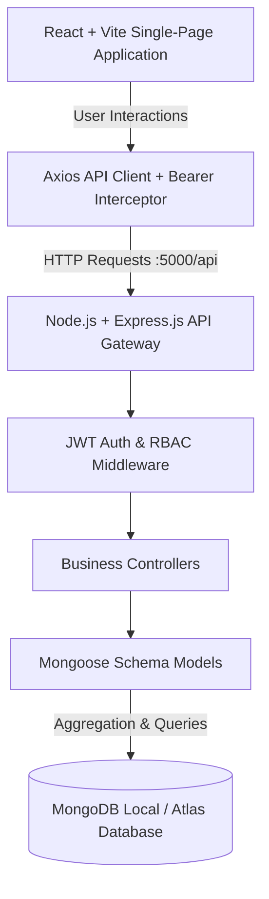

# Inventory Management System (IMS)

A full-stack, enterprise-grade **Inventory Management & Supply Chain Tracking System** engineered to provide real-time multi-warehouse inventory monitoring, batch shelf-life auditing, atomic stock movements (`STOCK_IN`, `STOCK_OUT`, `TRANSFER`), role-based operational permissions, interactive analytics dashboards, and exportable business reports.

Built as a complete Full-Stack Development (FSD) capstone project using **Node.js, Express.js, MongoDB, Mongoose, React.js (Vite), and Vanilla CSS**.

---

## 🌟 Key Features

### 1. Authentication & Role-Based Access Control (RBAC)
- **JWT (JSON Web Token)** stateless session authentication with token expiration (`7d`).
- Secure password hashing using **bcryptjs** with cryptographic salt rounds.
- Role-based authorization separating **Admin** (master catalog CRUD, batch configuration, administrative overrides) and **Staff** (stock intake, dispatch, warehouse transfers, report viewing).
- Axios request interceptor injecting Bearer tokens, with automatic 401 redirect to `/login`.

### 2. Master Data Management (Catalog)
- **Products**: SKU uniqueness enforcement, category associations, pricing, and configurable reorder level thresholds.
- **Categories**: Taxonomical grouping with active/inactive status switches.
- **Suppliers**: Comprehensive vendor directory with contact details and vendor performance tracking.
- **Locations**: Multi-warehouse spatial hierarchy tracking warehouses, stores, and distribution centers.
- **Batches**: Batch number tracking, manufacturing dates, expiration dates, and supplier provenance.

### 3. Inventory Control & Operations
- **Stock Intake (Stock IN)**: Goods receipt workflow with dynamic batch creation or upserting, maintaining full provenance and audit logs.
- **Stock Issue (Stock OUT)**: Goods dispatch workflow strictly preventing negative stock with real-time availability checks.
- **Inter-Warehouse Transfer**: Two-phase atomic transfer moving inventory between warehouses while maintaining cross-system inventory equilibrium.
- **Resilient Transactions**: Native MongoDB sessions on Replica Sets with automated compensation rollbacks for standalone MongoDB environments.
- **Dynamic Status Engine**:
  - `IN_STOCK`: Quantity $> \text{Reorder Level}$.
  - `LOW_STOCK`: $0 < \text{Quantity} \le \text{Reorder Level}$.
  - `OUT_OF_STOCK`: $\text{Quantity} = 0$.
  - `EXPIRING_SOON`: Current Date $\le \text{Expiry Date} \le \text{Current Date} + 30\text{ days}$.
  - `EXPIRED`: $\text{Expiry Date} < \text{Current Date}$.

### 4. Interactive Dashboard & Analytics
- **8 Live KPI Metric Cards**: Total Products, Total Stock Units, Low Stock Alerts, Out of Stock Alerts, Active Locations, Active Suppliers, Categories, and Total Batches.
- **Location Distribution Chart**: Responsive bar visualization showing exact quantities and percentage of total stock per warehouse.
- **Time-Series Stock Movement Chart**: Interactive grouped SVG chart comparing daily Stock IN, Stock OUT, and Transfers with interactive period switcher (`7 Days`, `30 Days`, `90 Days`) and hover tooltips.
- **Live Deficit & Expiry Tables**: Immediate visibility into items needing reordering or nearing expiration.

### 5. Exportable Business Reports & CSV Export
- **Inventory Report**: Filterable by product, category, location, and status with pagination.
- **Low Stock Report**: Automatically computes deficit difference (`reorderLevel - quantity`).
- **Out of Stock Report**: Depleted stock audits.
- **Expiry Report**: Filterable by expired vs. expiring soon.
- **Stock Movement Report**: Complete audit trail filterable by type, warehouse, user, and date ranges.
- **Location Inventory Report**: Multi-warehouse spatial stock report with product breakdowns.
- **Client-Side CSV Export**: Formatted, quoted, and UTF-8 BOM compliant CSV downloads for Excel compatibility (`inventory-report.csv`, `low-stock-report.csv`, etc.).

---

## 🏗️ System Architecture



---

## 🛠️ Technology Stack

| Layer | Technology | Description |
| :--- | :--- | :--- |
| **Frontend** | React 19 + Vite | High-performance modern Single-Page Application framework |
| **Routing** | React Router v7 | Declarative nested routing with layout outlets and protected routes |
| **Styling** | Vanilla CSS3 | Custom dark-mode design system with CSS custom properties |
| **HTTP Client**| Axios | Promise-based HTTP client with request/response interceptors |
| **Backend** | Node.js (v18+) + Express 5 | High-throughput asynchronous REST API server |
| **Database** | MongoDB (v6.0+) | NoSQL document database optimized for aggregations |
| **ODM** | Mongoose (v8/v9) | Object Data Modeling with schema validation & indexes |
| **Security** | JWT + bcryptjs | Token-based stateless authentication & password salting |

---

## 📁 Project Directory Structure

```
inventory-management-system/
├── client/                      # React Frontend Application
│   ├── src/
│   │   ├── components/          # Reusable UI component library (15+ components)
│   │   │   ├── Badge.jsx        # Dynamic status & movement badges
│   │   │   ├── Button.jsx       # Custom styled buttons with variants
│   │   │   ├── Card.jsx         # Card containers with headers & actions
│   │   │   ├── LocationChart.jsx# Warehouse inventory distribution bar chart
│   │   │   ├── MovementChart.jsx# Multi-series time-series SVG movement chart
│   │   │   ├── Modal.jsx        # Accessible popup dialog with backdrop dismiss
│   │   │   ├── Navbar.jsx       # Top navigation bar with user profile
│   │   │   ├── Pagination.jsx   # Numeric pagination controls
│   │   │   ├── ProtectedRoute.jsx# Auth guard redirecting to /login
│   │   │   ├── Sidebar.jsx      # Navigation sidebar with responsive toggle
│   │   │   └── Table.jsx        # Dark theme dynamic data table
│   │   ├── context/
│   │   │   ├── AuthContext.jsx  # Authentication state, login/logout, RBAC
│   │   │   └── ToastContext.jsx # Global alert notification banner system
│   │   ├── layouts/
│   │   │   └── MainLayout.jsx   # Shell layout integrating Navbar & Sidebar
│   │   ├── pages/               # Functional views (12 distinct pages)
│   │   │   ├── Batches.jsx      # Batch tracking & shelf-life monitoring
│   │   │   ├── Categories.jsx   # Product category CRUD management
│   │   │   ├── Dashboard.jsx    # Real-time analytics, charts & metric cards
│   │   │   ├── Inventory.jsx    # Stock levels with computed status badges
│   │   │   ├── Locations.jsx    # Warehouse locations & capacity tracking
│   │   │   ├── Login.jsx        # User authentication with show/hide password
│   │   │   ├── Products.jsx     # Master catalog CRUD with SKU & reorder levels
│   │   │   ├── Reports.jsx      # Multi-tab report suite with CSV export
│   │   │   ├── StockIn.jsx      # Inventory intake transaction form
│   │   │   ├── StockOut.jsx     # Inventory issue transaction form
│   │   │   ├── StockTransfer.jsx# Inter-warehouse atomic transfer form
│   │   │   └── Suppliers.jsx    # Vendor & supplier directory management
│   │   ├── services/
│   │   │   └── api.js           # Central Axios client with interceptors
│   │   ├── utils/
│   │   │   └── csvExport.js     # UTF-8 compliant CSV generator & downloader
│   │   ├── App.jsx              # Application router configuration
│   │   └── index.css            # Unified CSS design system
│   └── package.json
│
├── server/                      # Node.js + Express Backend API
│   ├── config/
│   │   └── db.js                # MongoDB Mongoose connection handler
│   ├── controllers/
│   │   ├── authController.js    # Register, login, /me profile
│   │   ├── batchController.js   # Batch lifecycle with quantity guardrails
│   │   ├── categoryController.js# Category CRUD
│   │   ├── dashboardController.js# Analytics aggregations & daily movements
│   │   ├── inventoryController.js# Dynamic stock status calculations
│   │   ├── locationController.js# Warehouse CRUD
│   │   ├── productController.js # Product catalog CRUD & SKU uniqueness
│   │   ├── reportController.js  # 6 specialized reporting endpoints
│   │   ├── stockController.js   # Stock IN, OUT, Transfer & Movements
│   │   └── supplierController.js# Supplier directory CRUD
│   ├── middleware/
│   │   ├── authMiddleware.js    # Bearer token validation & role authorization
│   │   └── errorMiddleware.js   # 404 handler and central error responder
│   ├── models/                  # Mongoose Schema definitions
│   │   ├── Batch.js             # Product batches with indexes on location & expiry
│   │   ├── Category.js          # Product taxonomies
│   │   ├── Location.js          # Warehouse physical locations
│   │   ├── Product.js           # Master products with unique SKUs
│   │   ├── StockMovement.js     # Immutable movement audit logs
│   │   ├── Supplier.js          # Supplier records
│   │   └── User.js              # User credentials with bcrypt pre-save hooks
│   ├── routes/                  # Express route routers
│   ├── utils/
│   │   ├── seedAdmin.js         # Command-line administrative seed script
│   │   └── transaction.js       # Standalone & Replica-set transaction abstraction
│   ├── server.js                # API entry point & route registration
│   └── package.json
└── README.md
```

---

## ⚙️ Installation & Setup Guide

### Prerequisites
- [Node.js](https://nodejs.org/) v18.0.0 or higher.
- [MongoDB Community Server](https://www.mongodb.com/try/download/community) installed and running locally on port `27017` (or MongoDB Atlas connection URI).

### 1. Setup Backend
Navigate to `server` folder:
```bash
cd server
npm install
```

Configure your environment variables by copying `.env.example`:
```bash
cp .env.example .env
```
*(Ensure `MONGO_URI`, `JWT_SECRET`, and `ADMIN_PASSWORD` are defined in `server/.env`)*.

### 2. Seed Initial Admin Account
Run the database seeder to establish the default administrative account:
```bash
npm run seed:admin
```

### 3. Setup Frontend
Navigate to `client` folder and install dependencies:
```bash
cd ../client
npm install
```

---

## 🚀 Running the Application

### 1. Start MongoDB
Ensure the local MongoDB service is running:
```powershell
Get-Service MongoDB
```

### 2. Start Backend API Server
From `server/`:
```bash
npm run dev
# Server will listen on http://localhost:5000
```
Verify health: [http://localhost:5000/api/health](http://localhost:5000/api/health) $\rightarrow$ `{ "success": true, "message": "Inventory Management API is running" }`.

### 3. Start Frontend Client
From `client/`:
```bash
npm run dev
# Application available at http://localhost:5173
```

---

## 🔐 Credentials & Default Accounts

| Role | Email | Password | Permissions |
| :--- | :--- | :--- | :--- |
| **Administrator** | `admin@example.com` | `Admin@123` | Full access: CRUD on Products, Categories, Suppliers, Locations, Batches, Stock Transactions, Reports & User Management |
| **Warehouse Staff**| `staff@example.com` | `Staff@123` | Operational access: Stock IN, Stock OUT, Stock Transfer, Inventory View, Reports, Audit History |

---

## 📡 REST API Reference

### Authentication & Users
- `POST /api/auth/register` — Register user account (Public/Admin).
- `POST /api/auth/login` — Authenticate user and issue JWT bearer token.
- `GET /api/auth/me` — Retrieve authenticated user profile.
- `GET /api/users` — Admin list of all registered users.

### Products, Categories, Suppliers & Locations
- `GET / POST / PUT / DELETE /api/products` — Catalog items with SKU, unit price, and reorder levels.
- `GET / POST / PUT / DELETE /api/categories` — Categories management.
- `GET / POST / PUT / DELETE /api/suppliers` — Vendor contacts.
- `GET / POST / PUT / DELETE /api/locations` — Warehouse facilities.

### Batch & Inventory Tracking
- `GET /api/batches` — Multi-criteria batch query with expiry filtering.
- `POST / PUT / DELETE /api/batches` — Batch setup with guardrails preventing arbitrary stock tampering.
- `GET /api/inventory` — Live inventory status calculation.
- `GET /api/inventory/low-stock` — Items at or below reorder level.
- `GET /api/inventory/out-of-stock` — Items depleted to 0 units.
- `GET /api/inventory/expiry` — Batches expired or expiring within 30 days.

### Stock Operations & History
- `POST /api/stock/in` — Record incoming inventory batch with user audit.
- `POST /api/stock/out` — Dispatch inventory with availability checks.
- `POST /api/stock/transfer` — Atomic inter-warehouse relocation.
- `GET /api/stock/movements` — Comprehensive chronological movement audit trail.

### Dashboard & Analytics
- `GET /api/dashboard/stats` — Overall KPI summary counts and movement totals.
- `GET /api/dashboard/inventory-by-location` — Stock quantities aggregated per warehouse.
- `GET /api/dashboard/stock-movements?period=30` — Daily movement trends for 7, 30, or 90 days.
- `GET /api/dashboard/low-stock` — Top critical low-stock items.
- `GET /api/dashboard/expiring` — Expired and soon-to-expire batch alerts.
- `GET /api/dashboard/recent-movements` — Latest 10 transaction records.

### Business Reports
- `GET /api/reports/inventory` — Filterable master inventory report.
- `GET /api/reports/low-stock` — Deficit report with difference calculations.
- `GET /api/reports/out-of-stock` — Depleted stock audit.
- `GET /api/reports/expiry` — Expiry and shelf-life tracking report.
- `GET /api/reports/stock-movements` — Filterable transaction logs with date ranges.
- `GET /api/reports/location-inventory` — Warehouse stock and product breakdowns.

---

## 🧪 Testing & Verification

The project includes an end-to-end automated verification suite covering all operational scenarios:
- **Phase 7 Dashboard Tests**: 45/45 passed (`testPhase7Dashboard.js`).
- **Phase 8 E2E Lifecycle Tests**: 30/30 passed (`testPhase8FinalE2E.js`), validating:
  1. Category, Supplier, and Warehouse creation.
  2. Product registration with reorder thresholds.
  3. Stock IN (100 units) $\rightarrow$ Inventory increases to 100.
  4. Stock OUT (20 units) $\rightarrow$ Inventory decreases to 80.
  5. Stock Transfer (30 units from Chennai to Bangalore) $\rightarrow$ Total inventory remains 80; warehouse distribution updates to 50 at Chennai and 30 at Bangalore.
  6. Movement audit trail verification (1 `STOCK_IN`, 1 `STOCK_OUT`, 1 `TRANSFER`).
  7. Low-stock trigger verification when reorder level exceeds available stock.
  8. Expiration threshold detection for past-dated batches.
  9. Verification of all 6 report API endpoints.
  10. Verification of CSV export data parameters.
  11. Unauthenticated request rejection (HTTP 401).

---

## 🔮 Future Enhancements

1. **Barcode / QR Code Scanner**: Direct camera or handheld hardware scanning for instant SKU identification during stock intake and issue.
2. **Automated Purchase Orders**: Automatic generation and dispatch of supplier purchase orders upon low-stock detection.
3. **Email / SMS Alerts**: Webhook or SMTP notifications for expiring pharmaceutical/food items and critical stockouts.
4. **PDF Bill & Waybill Generation**: Printable shipping waybills and transfer manifests using PDFKit.
5. **Multi-Currency Support**: Dynamic currency conversion for global supply chain procurement.

---

## 📜 License
Developed as an academic Full-Stack Web Development project. Released under the MIT License.
